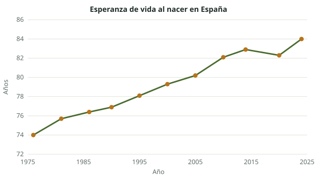

*Duración: 2 sesiones. Material: calculadora, regla, lápices de colores (opcional: hoja de cálculo).*

**Objetivo:** entender qué miden estas tres tasas, calcularlas e interpretar cómo han cambiado en España en los últimos 50 años y por qué.

## Sesión 1 · Parte A: ¿Qué son y cómo se calculan?

Para estudiar una población, los científicos no se fijan solo en cuántos nacimientos o defunciones hay, sino en cuántos hay **en proporción al número de habitantes**. Así se pueden comparar un pueblo pequeño y una gran ciudad, o España en 1976 y en 2024.

### 1. Tasa bruta de natalidad (TBN)

Es el número de nacimientos que se producen en un año por cada 1 000 habitantes. Se expresa en ‰ (por mil).

$$
TBN = \frac{\text{n.º de nacimientos en el año}}{\text{población total}}\cdot 1\,000
$$

Depende sobre todo del número de hijos por mujer, de la edad a la que se tienen los hijos y de cuántas personas jóvenes hay en la población.

### 2. Tasa bruta de mortalidad (TBM)

Es el número de defunciones que se producen en un año por cada 1 000 habitantes (‰).

$$
TBM = \frac{\text{n.º de defunciones en el año}}{\text{población total}}\cdot 1\,000
$$

**¡Cuidado!** Una población muy envejecida puede tener una TBM alta aunque su sanidad sea excelente: simplemente hay muchas personas mayores.

### 3. Esperanza de vida al nacer (EV)

Es el número medio de años que viviría una persona recién nacida si, a lo largo de toda su vida, se mantuvieran las condiciones de mortalidad de ese año. Se expresa en años.

No es una predicción exacta de cuánto vivirá cada persona: es un promedio que resume la salud de una población (alimentación, higiene, vacunas, sanidad, seguridad laboral, hábitos de vida…).

### 4. Saldo vegetativo o crecimiento natural

Es la diferencia entre nacimientos y defunciones. También puede expresarse como diferencia de tasas:

$$
\text{Saldo vegetativo} = \text{Nacimientos} - \text{Defunciones} \qquad \text{Tasa de crecimiento natural} = TBN - TBM\ (‰)
$$

Si es negativo, mueren más personas de las que nacen. (No incluye la inmigración ni la emigración).

### Ejemplo resuelto

En un pueblo de 8 000 habitantes hubo el año pasado 60 nacimientos y 96 defunciones.

$$
TBN = \frac{60}{8\,000}\cdot 1\,000 = 7{,}5\ ‰ \qquad TBM = \frac{96}{8\,000}\cdot 1\,000 = 12\ ‰
$$

Saldo vegetativo: $60 - 96 = -36$ personas. Tasa de crecimiento natural: $7{,}5 - 12 = -4{,}5$ ‰.

**Interpretación:** por cada 1 000 habitantes nacieron 7,5 y murieron 12; el pueblo pierde población de forma natural.

### Actividades de la Parte A

**A1. Comprensión.** Explica con tus palabras la diferencia entre «número de nacimientos» y «tasa de natalidad». ¿Por qué es más útil la tasa para comparar dos lugares?

**A2.** Una ciudad de 250 000 habitantes registró 1 750 nacimientos y 2 225 defunciones en un año.

- a) Calcula la TBN y la TBM.
- b) Calcula el saldo vegetativo y la tasa de crecimiento natural.
- c) ¿La ciudad gana o pierde población de forma natural? Justifícalo.

**A3. Problema inverso.** En 2024 España tenía unos 48,6 millones de habitantes, una TBN de 6,5 ‰ y una TBM de 8,9 ‰.

- a) ¿Cuántos nacimientos hubo aproximadamente? ¿Y cuántas defunciones?
- b) Calcula el saldo vegetativo aproximado.

**A4. Verdadero o falso.** Justifica cada respuesta.

- a) Si la esperanza de vida es de 84 años, todas las personas morirán a los 84 años.
- b) Un país con muchos ancianos puede tener una TBM más alta que un país pobre con población joven.
- c) Si el saldo vegetativo es negativo, la población del país tiene que disminuir obligatoriamente.

**A5. Ciencia y salud.** Escribe tres avances científicos o sociales que hayan hecho aumentar la esperanza de vida. Para cada uno, indica si está relacionado con la Biología, la Química/Física o las Matemáticas.

> **¿Sabías que…?** La mortalidad infantil (defunciones de menores de un año por cada 1 000 nacidos vivos) era de unos 17 en España en 1976 y de unos 3 en 2024. Reducir la mortalidad infantil es una de las causas que más hace subir la esperanza de vida.

## Sesión 2 · Parte B: España en los últimos 50 años

La siguiente tabla recoge los valores de estas tasas en España (población residente).

| Año | TBN (‰) | TBM (‰) | TBN − TBM (‰) | Esperanza de vida (años) |
| --- | --- | --- | --- | --- |
| 1976 | 18,7 | 8,3 | | 74,0* |
| 1981 | 14,1 | 7,8 | | 75,7* |
| 1986 | 11,4 | 8,0 | | 76,4* |
| 1990 | 10,3 | 8,5 | | 76,9 |
| 1995 | 9,2 | 8,7 | | 78,1 |
| 2000 | 9,9 | 8,9 | | 79,3 |
| 2005 | 10,7 | 8,9 | | 80,2 |
| 2010 | 10,4 | 8,2 | | 82,1 |
| 2014 | 9,1 | 8,5 | | 82,9 |
| 2020 | 7,2 | 10,4 | | 82,3 |
| 2024 | 6,5 | 8,9 | | 84,0 |

*Fuente: INE, Movimiento Natural de la Población e Indicadores Demográficos Básicos. Valores redondeados a una cifra decimal. (\*) Valores aproximados: el INE cambió el método de cálculo de la esperanza de vida en 1986.*

### Actividades de la Parte B

**B1.** Completa la columna TBN − TBM de la tabla. ¿En qué año aparece por primera vez un valor negativo?

**B2. Representación gráfica.** Representa la evolución de la TBN y de la TBM con dos líneas de distinto color (en papel cuadriculado o en una hoja de cálculo). Eje horizontal: años de 1975 a 2025; eje vertical: tasa (‰) de 0 a 20. Pon título y leyenda.

**B3. Interpreta tu gráfica.**

- a) Describe cómo ha evolucionado la natalidad. ¿En qué periodo cae más rápido?
- b) ¿Ocurre algo parecido con la mortalidad? ¿Por qué crees que la TBM apenas ha cambiado mientras la esperanza de vida ha subido tanto? (Pista: piensa en la edad de la población).
- c) ¿Qué ocurrió en 2020 para que la TBM llegara a 10,4 ‰? ¿Qué le pasó a la esperanza de vida ese año?

**B4. Cálculos con los datos.**

- a) Calcula la variación porcentual de la TBN entre 1976 y 2024:

$$
\frac{\text{valor final} - \text{valor inicial}}{\text{valor inicial}}\cdot 100
$$

- b) ¿Cuántos años ha aumentado la esperanza de vida entre 1976 y 2024? ¿Cuántos años de media por cada década?
- c) Calcula la media de la TBM de los 11 años de la tabla. ¿Es muy diferente de los valores de cada año? ¿Qué te indica?

**B5. Esperanza de vida.** Observa la gráfica:

- a) ¿La relación entre el año y la esperanza de vida es aproximadamente lineal? Justifícalo.
- b) Si siguiera creciendo al mismo ritmo medio que entre 1976 y 2024, estima la esperanza de vida en 2050. ¿Te parece realista que crezca siempre igual? ¿Por qué?

**B6. Consecuencias.** Con una natalidad baja y una esperanza de vida alta, la población envejece. Indica dos consecuencias para la sociedad (sanidad, pensiones, colegios, trabajo…) y una posible medida para afrontarlas.

**B7. Pensamiento crítico.** En una red social aparece el mensaje: «En 2020 la tasa de mortalidad fue de 10,4 ‰, así que en España murió el 10 % de la población». ¿Es correcto? Explica el error con un cálculo.

**B8. Reflexión final.** Escribe un breve texto (5–6 líneas) explicando qué has aprendido sobre la evolución de la población española y qué papel ha jugado la ciencia en ella.

## Rúbrica de corrección

| Indicador | Excelente (4) | Notable (3) | Suficiente (2) | Insuficiente (1) | Crit. |
| --- | --- | --- | --- | --- | --- |
| Conceptos y definiciones (A1, A4) | Define con precisión TBN, TBM, EV y saldo vegetativo, y distingue valor absoluto de tasa. | Define correctamente los conceptos con alguna imprecisión menor. | Define los conceptos de forma básica o con errores parciales. | No distingue los conceptos o los confunde. | 9.1 |
| Cálculo de tasas y porcentajes (A2, A3, B1, B4) | Aplica las fórmulas sin errores, con unidades (‰, %, años) y procedimiento claro. | Cálculos correctos con algún descuido en unidades o redondeos. | Plantea bien pero comete errores de cálculo, o resuelve solo parte. | No sabe plantear las fórmulas o no realiza los cálculos. | 6.4 |
| Representación gráfica (B2) | Gráfica precisa, dos series diferenciadas, escala, título y leyenda. | Gráfica correcta con falta de algún elemento (título o leyenda). | Gráfica con errores en algunos puntos o poco legible. | No representa o la gráfica no corresponde a los datos. | 6.2, 7.4 |
| Interpretación de datos y gráficas (B3, B5) | Describe tendencias, identifica anomalías (2020) y relaciona TBM con envejecimiento. | Describe tendencias correctamente; la explicación de causas es incompleta. | Describe solo lo evidente sin relacionar variables. | No interpreta o la interpretación es errónea. | 6.1, 9.1 |
| Relación ciencia–sociedad (A5, B6) | Relaciona varios avances científicos y consecuencias sociales con argumentos sólidos. | Aporta ejemplos adecuados con argumentación sencilla. | Aporta algún ejemplo sin justificar. | No establece relaciones. | 3.1, 3.2 |
| Pensamiento crítico (B4c, B5b, B7) | Detecta el error del mensaje con cálculo y valora límites de las predicciones. | Detecta el error pero la justificación es incompleta. | Intuye el error sin justificarlo. | Acepta el mensaje como correcto. | 10.2 |
| Comunicación y presentación (B8 y conjunto) | Expresión clara, terminología científica correcta, ficha ordenada y completa. | Expresión correcta con pequeños fallos de orden o vocabulario. | Expresión poco clara o ficha incompleta. | Ficha muy incompleta o desordenada. | 9.2 |

**Calificación:** se suman las puntuaciones de los 7 indicadores (máximo 28) y se pasa a escala 10:

$$
\text{Nota} = \frac{\text{puntos obtenidos}}{28}\cdot 10
$$

## Criterios de evaluación

Ámbito Científico-Tecnológico, 2.º curso del PDC. Orden de 30 de mayo de 2023 (BOJA n.º 104), Anexo IV.

| Criterio | Actividades |
| --- | --- |
| 3.1 | A5, B5 |
| 3.2 | A5, B6 |
| 6.1 | B3 |
| 6.2 | B2 |
| 6.4 | A2, A3, B1, B4 |
| 7.4 | B2, B5 |
| 9.1 | A1, A4, B3 |
| 9.2 | B8 |
| 10.2 | B7 |
