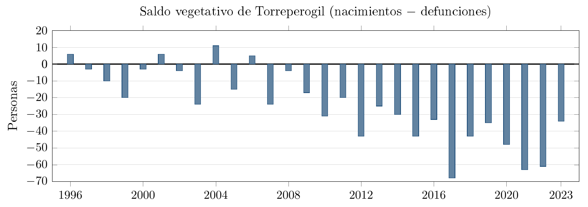
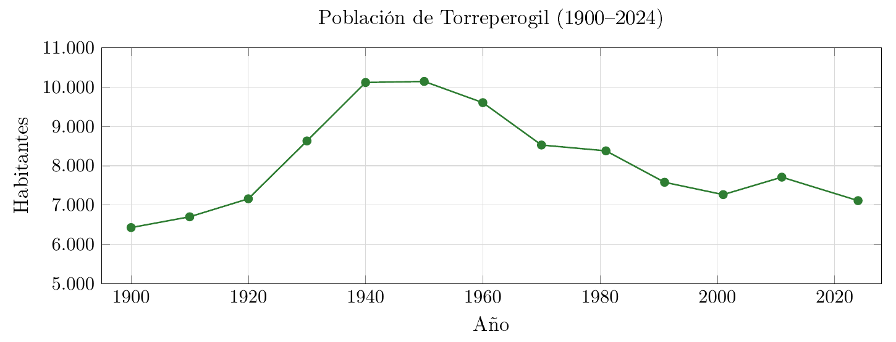

*Trabajo de campo: natalidad, mortalidad y envejecimiento en nuestro pueblo.*

- **Organización:** equipos de 3 personas.
- **Duración:** 2 sesiones en clase + 1 semana de trabajo de campo.
- **Material:** calculadora, regla, lápices de colores, móvil para grabar notas (opcional), hoja de cálculo (opcional).
- **Requisito previo:** haber trabajado la [Ficha 1: ¿Cuántos nacemos, cuántos morimos y cuánto vivimos?](../act-p2-f1-natalidad-mortalidad/)

> **Pregunta de investigación.** ¿Cómo ha cambiado la población de Torreperogil y en qué se parece o se diferencia de la de España?

Antes de empezar, escribid vuestra **hipótesis** (lo que creéis que vais a encontrar). Pensad en: ¿nacen más personas de las que mueren?, ¿el pueblo crece o pierde habitantes?, ¿está más envejecido que España?

### Plan de trabajo

| Fase | Qué haremos |
| --- | --- |
| Fase 1 · Sesión 1 | Analizamos datos oficiales del INE sobre Torreperogil y preparamos el trabajo de campo. |
| Fase 2 · Fuera de clase (1 semana) | Encuesta familiar, entrevista a una persona mayor e inventario de servicios del pueblo. |
| Fase 3 · Sesión 2 | Reunimos los datos de toda la clase, contrastamos la hipótesis y elaboramos un póster con conclusiones y propuestas. |

## Fase 1 · Sesión 1: Lo que dicen los datos oficiales

### 1.1 Nacimientos y defunciones en Torreperogil

| Año | Población | Nacim. | Defunc. | TBN (‰) | TBM (‰) | Saldo vegetativo |
| --- | --- | --- | --- | --- | --- | --- |
| 1996 | 7 493 | 85 | 79 | | | |
| 2000 | 7 424 | 79 | 82 | | | |
| 2005 | 6 813 | 72 | 87 | | | |
| 2010 | 7 516 | 65 | 96 | | | |
| 2015 | 7 548 | 61 | 104 | | | |
| 2020 | 7 222 | 44 | 92 | | | |
| 2023 | 7 108 | 51 | 85 | | | |

*Fuente: INE (Padrón municipal a 1 de enero y Movimiento Natural de la Población).*

Recuerda:

$$
TBN = \frac{\text{nacimientos}}{\text{población}}\cdot 1\,000 \qquad TBM = \frac{\text{defunciones}}{\text{población}}\cdot 1\,000
$$

**1.1** Completad la tabla (redondead a una cifra decimal).

**1.2** Comparad Torreperogil con España. Completad la columna de Torreperogil con vuestros resultados:

| Año | TBN España (‰) | TBN Torreperogil (‰) | TBM España (‰) | TBM Torreperogil (‰) |
| --- | --- | --- | --- | --- |
| 2000 | 9,9 | | 8,9 | |
| 2010 | 10,4 | | 8,2 | |
| 2015 | 9,0 | | 9,1 | |
| 2020 | 7,2 | | 10,4 | |
| 2023 | 6,6 | | 9,0 | |

¿En qué tasa se diferencia más Torreperogil de España? ¿A qué creéis que se debe?

### 1.2 El saldo vegetativo año a año

**1.3** ¿Desde qué año el saldo vegetativo es siempre negativo? ¿Qué significa eso para el pueblo?

**1.4** En un pueblo pequeño las cifras «saltan» mucho de un año a otro (por ejemplo, 37 nacimientos en 2021 y 52 en 2022). Por eso es mejor usar **medias de varios años**. Sabiendo que en 1996, 1997 y 1998 nacieron 85, 77 y 80 bebés, y en 2021, 2022 y 2023 nacieron 37, 52 y 51, calculad la media de nacimientos de cada trienio y el porcentaje de variación entre ambos.

### 1.3 Un siglo de población

**1.5** ¿En qué año alcanzó el pueblo su máximo de población? ¿Cuánto ha variado (en porcentaje) desde entonces hasta 2024 (7 113 habitantes)?

**1.6** Entre 1950 y 1980 el pueblo perdió casi 2 000 habitantes, pero en esos años nacían más personas de las que morían. ¿Cómo es posible? *(Pista: el saldo vegetativo no lo explica todo).* Preguntadlo también en la entrevista de la Fase 2.

### 1.4 La pirámide de población de 2024

| Edad | Hombres | Mujeres |
| --- | --- | --- |
| 0–4 | 129 | 116 |
| 5–9 | 146 | 134 |
| 10–14 | 159 | 159 |
| 15–19 | 211 | 192 |
| 20–24 | 187 | 193 |
| 25–29 | 186 | 198 |
| 30–34 | 222 | 199 |
| 35–39 | 231 | 210 |
| 40–44 | 237 | 247 |
| 45–49 | 263 | 258 |
| 50–54 | 286 | 258 |
| 55–59 | 302 | 294 |
| 60–64 | 266 | 270 |
| 65–69 | 212 | 195 |
| 70–74 | 146 | 183 |
| 75–79 | 112 | 184 |
| 80–84 | 93 | 128 |
| 85 y más | 102 | 203 |
| **Total** | **3 490** | **3 621** |

*Fuente: INE, Padrón 1-1-2024.*

**1.7** Dibujad la pirámide: barras de hombres a la izquierda y de mujeres a la derecha (en el PDF tenéis la cuadrícula; cada cuadrito pequeño = 25 personas).

**1.8** ¿Qué forma tiene la pirámide: de base ancha («pagoda»), de bulbo («hucha») o de campana? ¿Qué nos dice esa forma?

**1.9** Calculad:

- a) El porcentaje de personas de 65 años o más.
- b) El **índice de envejecimiento**: $\dfrac{\text{personas de 65 o más}}{\text{personas de 0 a 14}}\cdot 100$. ¿Qué significa que sea mayor que 100?
- c) En el grupo de 85 y más, ¿cuántas mujeres hay por cada hombre? Relacionadlo con la esperanza de vida de hombres y mujeres.

> **¿Y la esperanza de vida de Torreperogil?** El INE no calcula la esperanza de vida de municipios tan pequeños: con tan pocos fallecimientos al año, el resultado cambiaría mucho por azar. Por eso usamos la de la provincia de Jaén: 82,8 años en 2024 (hombres 80,2; mujeres 85,4), frente a 84,0 en España. *(Fuente: INE, Indicadores Demográficos Básicos).*

**1.10** ¿Por qué creéis que una muestra pequeña da resultados poco fiables? Poned un ejemplo con monedas o dados.

## Fase 2 · Trabajo de campo (fuera de clase, 1 semana)

> **Normas del trabajo de campo**
>
> - Las encuestas son **anónimas y voluntarias**: no anotéis nombres ni datos que identifiquen a nadie.
> - Pedid siempre **permiso** antes de entrevistar o grabar, y respetad a quien prefiera no contestar alguna pregunta.
> - Repartid las tareas dentro del equipo (C1, C2 y C3) y anotadlo.

### C1 · Encuesta «Tres generaciones»

Cada miembro del equipo encuesta a su familia y, si es posible, a dos familias más de vecinos o conocidos. Se pregunta por el número de hijos que tuvo cada generación.

| Familia | N.º de hermanos del alumno/a (incluido él/ella) | N.º de hijos que tuvieron sus abuelos (materno) | N.º de hijos que tuvieron sus abuelos (paterno) | ¿Algún miembro emigró fuera del pueblo? (sí/no) |
| --- | --- | --- | --- | --- |
| 1 | | | | |
| 2 | | | | |
| 3 | | | | |
| … | | | | |

### C2 · Entrevista a una persona mayor del pueblo (70 años o más)

Anotad la edad aproximada, el sexo y si ha vivido siempre en el pueblo.

- **E1.** ¿Cuántos hermanos eran en su casa? ¿Sobrevivieron todos hasta ser adultos?
- **E2.** ¿Dónde nacían los niños cuando usted era joven: en casa o en un hospital? ¿Quién atendía los partos?
- **E3.** ¿Había médico en el pueblo? ¿Qué se hacía si alguien se ponía grave?
- **E4.** ¿Qué enfermedades eran frecuentes en los niños? ¿Recuerda cuándo empezaron las vacunas?
- **E5.** ¿En qué trabajaba la gente? ¿Era un trabajo duro o peligroso para la salud?
- **E6.** ¿Se marchó mucha gente del pueblo? ¿Cuándo y a dónde? ¿Por qué?
- **E7.** ¿Por qué cree que hoy las familias tienen menos hijos?
- **E8.** ¿Qué es lo que más ha cambiado en el pueblo desde que era joven?

### C3 · Inventario de servicios del pueblo

Recorred el pueblo (o usad un mapa en línea y preguntad en el Ayuntamiento) y anotad cuántos hay de cada tipo. Sacad fotos de las fachadas si os dejan (sin personas).

| Servicio | Cantidad | Observaciones |
| --- | --- | --- |
| Escuelas infantiles / guarderías | | |
| Colegios de Primaria | | |
| Institutos | | |
| Parques infantiles | | |
| Centro de salud / consultorio | | |
| Farmacias | | |
| Residencias de mayores / centros de día | | |
| Hogar del pensionista o centro de mayores | | |
| Zonas biosaludables (aparatos de ejercicio para mayores) | | |

## Fase 3 · Sesión 2: Ponemos en común y concluimos

### 3.1 Datos de toda la clase (encuesta C1)

Reunid en la pizarra (o en una hoja de cálculo compartida) los datos de todos los equipos.

| | Generación abuelos (hijos de los bisabuelos)* | Generación padres (hijos de los abuelos) | Generación alumnado (hermanos del alumno/a) |
| --- | --- | --- | --- |
| N.º de familias encuestadas | | | |
| Media de hijos por familia | | | |
| Moda | | | |
| Valor máximo | | | |

*\* Si en la entrevista C2 se recogió el número de hermanos de la persona mayor, se puede usar como dato de esta generación.*

**3.1** Representad las medias de las tres generaciones en un diagrama de barras.

**3.2** ¿Coincide la tendencia de vuestra encuesta con la caída de la natalidad que muestran los datos del INE? ¿Por qué nuestra muestra puede no ser representativa de todo el pueblo?

### 3.2 Lo que nos contaron (entrevista C2)

**3.3** Elegid las dos respuestas de las entrevistas que mejor explican por qué ha aumentado la esperanza de vida y dos que expliquen por qué ha bajado la natalidad.

**3.4** ¿Qué os contaron sobre la emigración? ¿Ayuda a responder a la pregunta 1.6?

### 3.3 Conclusiones

**3.5 Contraste de la hipótesis.** Releed vuestra hipótesis. ¿Se confirma, se confirma en parte o se rechaza? Justificadlo con al menos tres datos concretos.

**3.6 Servicios (C3).** Con una población cada vez más envejecida, ¿creéis que los servicios del pueblo están bien equilibrados entre jóvenes y mayores? ¿Qué falta o qué sobra?

**3.7 Propuestas.** Escribid dos propuestas realistas que podría poner en marcha el Ayuntamiento: una para atraer o mantener población joven y otra para mejorar la calidad de vida de las personas mayores.

> **Producto final: póster «Torreperogil en cifras».** Cada equipo elabora un póster (cartulina A3 o infografía digital con Canva, Genially, etc.) que incluya:
>
> - Pregunta de investigación e hipótesis.
> - Al menos dos gráficos: la pirámide de población y otro elegido por el equipo.
> - Tres datos destacados de Torreperogil comparados con España.
> - Una frase o testimonio de la entrevista (con permiso y sin nombre).
> - Conclusión y las dos propuestas para el pueblo.
> - Fuentes utilizadas (INE y trabajo de campo propio).

## Rúbrica de evaluación

| Indicador | Excelente (4) | Notable (3) | Suficiente (2) | Insuficiente (1) | Crit. |
| --- | --- | --- | --- | --- | --- |
| Hipótesis y planificación | Formula una hipótesis clara y comprobable y planifica el reparto de tareas. | Hipótesis adecuada; planificación con algún hueco. | Hipótesis vaga o poco comprobable. | No formula hipótesis ni planifica. | 7.1 |
| Toma de datos de campo (C1, C2, C3) | Recoge todos los datos con rigor, respetando anonimato y permisos. | Recoge la mayoría de datos correctamente. | Datos incompletos o poco cuidados. | No realiza el trabajo de campo. | 7.3 |
| Cálculos (1.1–1.4, 1.5, 1.9) | Tasas, porcentajes, medias e índices correctos y con unidades. | Cálculos correctos con algún descuido. | Errores en varios cálculos. | No sabe plantear los cálculos. | 6.4 |
| Gráficos (pirámide, barras) | Gráficos precisos, con escala, título y leyenda. | Gráficos correctos con algún elemento ausente. | Gráficos con errores o poco legibles. | No los realiza o no corresponden a los datos. | 7.4 |
| Análisis y contraste de la hipótesis | Contrasta la hipótesis con tres o más datos y valora la representatividad de la muestra. | Contrasta con datos, pero sin valorar limitaciones. | Conclusión poco apoyada en datos. | No contrasta la hipótesis. | 7.2, 7.4 |
| Relación con el entorno y propuestas | Relaciona datos, servicios y testimonios; propuestas realistas y argumentadas. | Propuestas adecuadas con argumentación sencilla. | Propuestas poco relacionadas con los datos. | Sin propuestas. | 3.2, 6.3 |
| Póster y comunicación | Póster claro y completo, terminología correcta y fuentes citadas. | Póster correcto con algún elemento ausente. | Póster incompleto o poco claro. | No presenta póster. | 7.6, 9.2 |
| Trabajo en equipo | Todos participan, se escuchan y se reparten tareas de forma equitativa. | Buena colaboración con pequeños desequilibrios. | Colaboración irregular. | No hay trabajo en equipo. | 11.3 |

**Calificación:**

$$
\text{Nota} = \frac{\text{puntos obtenidos}}{32}\cdot 10
$$

El indicador de trabajo en equipo puede completarse con una coevaluación entre los miembros del equipo.

## Criterios de evaluación

Ámbito Científico-Tecnológico, 2.º curso del PDC. Orden de 30 de mayo de 2023 (BOJA n.º 104), Anexo IV.

| Criterio | Actividades |
| --- | --- |
| 3.2 | C3, 3.6, 3.7 |
| 6.3 | 3.7, póster |
| 6.4 | 1.1–1.5, 1.9 |
| 7.1 | Hipótesis, 1.6 |
| 7.2 | 3.5 |
| 7.3 | C1, C2, C3 |
| 7.4 | 1.7, 3.1, 3.2 |
| 7.6 | Póster |
| 9.2 | Póster |
| 11.3 | Todo el trabajo |
